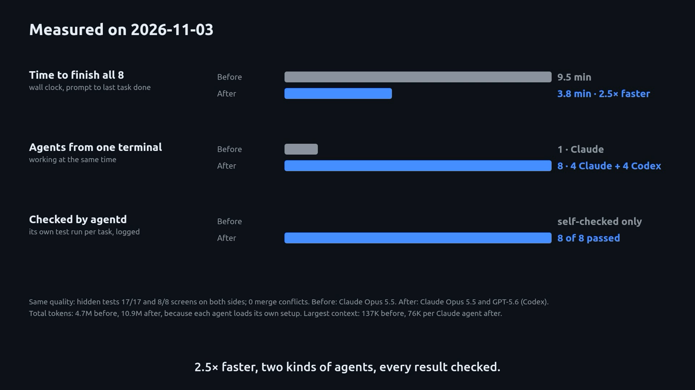

# agentd

[](https://libraos.com/docs/agentd/)

Measured on 2026-11-03: 8 screens in 3.8 min with 4 Claude + 4 Codex workers, against 9.5 min in one session: 2.5× faster, 8 of 8 results checked. [Watch the video](https://libraos.com/docs/agentd/).

agentd runs Claude Code and Codex as a team on your development machine. You describe the work in a chat, a planner splits it into tasks, workers build them in parallel in their own git worktrees, and you review every change before you merge it.

- **Your agents, connected.** agentd adds an MCP server, hooks and two skills to Claude Code and Codex, so every session shares one task ledger: who is working on what, handoffs, checks and results.
- **A local dashboard.** `agentd dash` opens Chat, Issues, Team and Insights: plan a request, watch each worker live, and merge its pull request.
- **Workers you can trust with a branch.** Each worker has a budget and a check command, commits on an `agentd/…` branch, and never pushes or merges.

Everything runs on your machine. This repository holds releases only: static binaries, the installer, the skills and their checksums.

**Documentation:** [libraos.com/docs/agentd](https://libraos.com/docs/agentd/) · **Setup in the LibraOS Console:** [console.libraos.com/agentd](https://console.libraos.com/agentd)

## Requirements

- Linux with systemd user services (tested). The macOS binaries are built and untested.
- git 2.25 or newer, with `user.name` and `user.email` set (workers commit).
- Claude Code or Codex, installed and signed in. One is enough. Codex workers also need `bwrap` (bubblewrap).
- Optional: `gh`, to sync pull requests and issues.

## Install

No GitHub login is needed. Download the installer, read it, then run it:

```sh
d="$(mktemp -d)"
curl -fsSL -o "$d/install.sh" https://github.com/libraos/agentd/releases/latest/download/install.sh
less "$d/install.sh"
sh "$d/install.sh"
agentd version
```

The installer checks the release's checksums and installs `agentd` to `~/.local/bin` with the `agentd` and `agentd-setup` skills. It changes no client configuration. To install a specific version, set `AGENTD_VERSION` to its tag first.

## Set up a repository

The quick way: start a new Claude Code or Codex session in your repository and paste:

> Set up AgentD for this repository. Connect my coding agents, initialize shared project knowledge, and help me run my first verified development task.

The setup skill runs the steps below and asks before it starts a paid worker. By hand:

```sh
cd /path/to/your/repo
agentd init      # the local ledger and systemd user services
agentd connect   # the agentd MCP server and hooks in Claude Code and Codex
agentd doctor    # each failure prints the command that fixes it
```

`init` and `connect` are safe to run again, and `--dry-run` shows what they would change. `agentd connect --repo-rule` optionally adds an untracked rule telling your sessions to send implementation work through agentd. For Claude workers, run `claude` in the repository once and trust it.

## Run work

From a terminal:

```sh
agentd user add YOUR_NAME --role owner   # once
export AGENTD_USER=YOUR_NAME             # who starts, and pays for, the workers
agentd run "Add a test for the parser" --budget 30m --check "go test ./..."
```

The worker commits on its own branch and prints a result card with the check, the changed files, time and cost. Or ask for the work in any Claude Code or Codex session in the repository.

From the dashboard:

```sh
agentd dash --serve 127.0.0.1:21480
agentd dash link --user YOUR_NAME        # open the printed link to sign in
```

Chat needs a model on an OpenAI-compatible gateway, set under `[gateway]` in `~/.local/share/agentd/config.toml`. To let Chat start workers, set `dispatch = true` under `[dash]`. A planner proposes one task per worker; nothing starts until you choose **Review and start**, then **Confirm and start**.

## Models and billing

agentd brings no model access of its own. Each worker uses its client's own Claude or ChatGPT login or API key, billed by that provider.

Or use one [LibraOS](https://console.libraos.com) model API key for both clients and the dashboard's Chat, billed in LibraOS credits or a Token Plan. Save the key alone in a file only you can read (`chmod 600`), then add to `config.toml`:

```toml
[gateway]                                    # the dashboard's Chat
url = "https://api.libraos.com/v1"
key_file = "~/.config/agentd/libraos.key"

[dispatch]                                   # Claude and Codex workers
claude_base_url = "https://api.libraos.com"
claude_key_file = "~/.config/agentd/libraos.key"
codex_base_url = "https://api.libraos.com/v1"
codex_key_file = "~/.config/agentd/libraos.key"
```

`agentd doctor` reports the gateway each worker uses. See [Models and billing](https://libraos.com/docs/agentd-models/) for the details.

## Upgrade and uninstall

**Upgrade:** run the installer again, then `systemctl --user restart agentd-notify.service`.

**Uninstall:** there is no command for this yet. Disable and delete the `agentd-*` units in `~/.config/systemd/user`, remove the `agentd` MCP server and hooks from `~/.claude.json`, `~/.claude/settings.json` and `~/.codex/config.toml`, then delete `~/.local/bin/agentd`, the two skills and `~/.local/share/agentd`, which holds your ledger.

## Report a problem

Open an issue here with what you ran, what you expected and the output of `agentd doctor`. Never paste keys or tokens.

## License

Free to use, not for resale. See [LICENSE](LICENSE).
