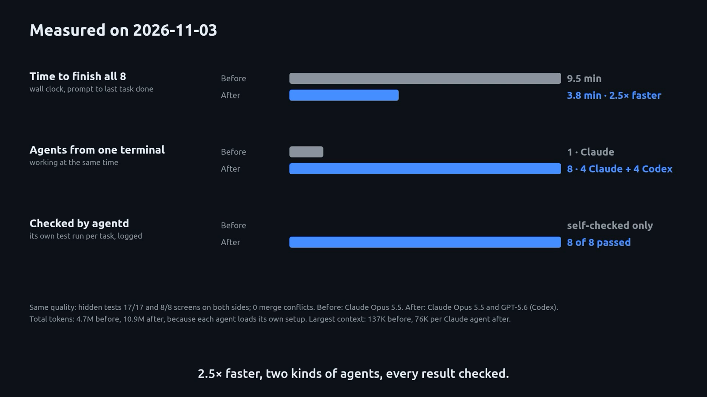

# LibraOS Engine

<div align="center">

[Docs](https://libraos.com/docs/agentd/) · [Console](https://console.libraos.com/agentd) · [Releases](https://github.com/libraos/engine/releases/latest) · [Report a problem](https://github.com/libraos/engine/issues)

<br />

[](https://github.com/libraos/engine/releases/latest)
[](https://github.com/libraos/engine/releases)
[](https://github.com/libraos/engine/commits/main)

</div>

LibraOS Engine runs Claude Code, Codex and opencode as a team on your development machine. Describe the work, and workers build it in parallel, each in its own git worktree with a budget and a test command. You review every change before it reaches GitHub.

It works with the coding agents you already use and the logins you already have. Everything runs on your machine.

Its command is `libraos-engine`.

[](https://libraos.com/docs/agentd/)

## What You Can Do

- Run several Claude Code, Codex and opencode workers at once from one terminal, without juggling sessions.
- Give each task a budget and a check. LibraOS Engine runs the check itself and records the result.
- Read a result card for every task: check, changed files, minutes and dollars.
- Open a draft pull request only when you say so. Workers never push, and LibraOS Engine never merges.
- Plan work in the dashboard's Chat, watch each worker live, and answer approvals from the Inbox.
- Let every agent session on the machine share one task ledger: who is working on what, handoffs and results.

## Installation

| Platform | Install |
| --- | --- |
| Linux, macOS | `curl -fsSL https://console.libraos.com/agentd/install.sh \| sh` |
| Windows | `irm https://console.libraos.com/agentd/install.ps1 \| iex` (PowerShell) |

The installer needs no login. It checks every file against the release's `SHA256SUMS`, then installs `libraos-engine`, with `libraos-core` and `agentd` kept as other names for it, and two Skills, `agentd` and `agentd-setup`. It changes no client configuration. To pin a version, set `AGENTD_VERSION` to its tag first. You can also download the binaries and both installers from the [latest release](https://github.com/libraos/engine/releases/latest) and read the script before running it.

**Earlier names.** LibraOS Engine was called LibraOS Core (until 2026-11-25) and before that agentd; the commands `libraos-core` and `agentd` still work, so existing scripts, services, MCP settings and the data directory keep working. This repository was `libraos/libraos-core` until 2026-11-24, and links to that name redirect here.

**Requirements:**

- Linux with systemd user services, macOS (services are LaunchAgents) or Windows, new in v0.1.7 (services are Task Scheduler tasks; LibraOS Engine needs [Git for Windows](https://git-scm.com/download/win) for its shell: `winget install --id Git.Git -e`).
- git 2.25 or newer, with `user.name` and `user.email` set, because workers commit.
- Claude Code or Codex, installed and signed in **before** LibraOS Engine, so the installer finds it and adds the Skills. One is enough. Claude Code: `curl -fsSL https://claude.ai/install.sh | bash` on Linux and macOS, `irm https://claude.ai/install.ps1 | iex` in PowerShell on Windows. Codex: `npm install -g @openai/codex` (Node.js 18 or newer). On Linux, Codex workers also need `bwrap` (bubblewrap); Windows has no equivalent, see [the docs](https://libraos.com/docs/agentd/).
- Optional: the GitHub CLI, signed in (`gh auth login`), to sync pull requests and issues and open draft PRs. Install it with `sudo apt install -y gh`, `brew install gh` or `winget install --id GitHub.cli`.

On Windows, open a new terminal after each install so the new PATH applies.

## Get Started

1. **Set up your repository.** Start a Claude Code or Codex session in it and paste:

   > Set up LibraOS Engine for this repository. Connect my coding agents, initialize shared project knowledge, and help me run my first verified development task.

   The setup Skill runs the steps below and asks before it starts a paid worker. By hand:

   ```sh
   cd /path/to/your/repo
   libraos-engine init      # asks you to accept the EULA once, then sets up the ledger, services and your agents
   libraos-engine doctor    # each failure prints the command that fixes it
   ```

   `init` connects every installed client, trusts the repository for Claude Code and adds you as its owner. It is safe to run again, and `--dry-run` shows what it would change. `libraos-engine connect --repo-rule` optionally adds an untracked rule telling your sessions to send implementation work through LibraOS Engine.

   No activation code or invitation is needed. Cloud Workers and the hosted knowledge base need only their key file from Console. `libraos-engine activate` optionally links this machine to your LibraOS account, for sending feedback and diagnostics; get the code at [console.libraos.com/agentd](https://console.libraos.com/agentd).

2. **Run a task:**

   ```sh
   libraos-engine run "Add a test for the parser" --budget 30m --check "go test ./..."
   ```

   The worker commits on its own `agentd/…` branch and prints a result card. When you are happy with it, `libraos-engine handoff pr ID` pushes the branch and opens a draft pull request. You can also ask for work in any connected Claude Code or Codex session.

## Dashboard

```sh
libraos-engine dash --serve 127.0.0.1:21480
libraos-engine dash link --user YOUR_NAME        # open the printed link to sign in
```

The dashboard has Overview, Tasks, Team, Insights, Chat and Settings, and an Inbox for what waits on you. Chat needs a model on an OpenAI-compatible gateway, set under `[gateway]` in `config.toml`. To let Chat start workers, set `dispatch = true` under `[dash]`. Nothing starts until a person presses **Start** on the proposed task.

This release serves the dashboard to one person, on this machine only. A dashboard shared by a team, with more people, invitations and remote workers, is the team server: LibraOS Team hosts it and Enterprise runs it in its own environment ([pricing](https://libraos.com/pricing/)). Any install can join one with `libraos-engine join LINK`, using the invitation link and your password.

## Install in Claude Code and Codex

LibraOS Engine is a program on your machine, not an extension installed from inside a client. Install it once, then `libraos-engine init` adds it to every client it finds. A client reads its MCP servers when a session starts, so close running sessions and start new ones afterwards.

**From a Claude Code session.** Run the installer in the session with the `!` prefix, then start a new session in your repository and paste the setup prompt from [Get Started](#get-started):

```text
! curl -fsSL https://console.libraos.com/agentd/install.sh | sh
```

**From Codex.** Run the installer in a terminal, then start a new Codex session in your repository and paste the same prompt. Install Codex before LibraOS Engine, or run the installer again afterwards, so the Skills are added for it.

What each step adds:

| | Claude Code | Codex |
| --- | --- | --- |
| Skills `agentd-setup` and `agentd` (installer) | `~/.claude/skills/` (`$CLAUDE_CONFIG_DIR/skills/` when set) | `~/.agents/skills/` |
| MCP server (`init`, `connect`) | User scope, in `~/.claude.json` | `[mcp_servers.agentd]` in `~/.codex/config.toml` (`$CODEX_HOME` when set), with `default_tools_approval_mode = "approve"` so Codex workers, which run without approval prompts, can call it |
| Hooks (`init`, `connect`) | `libraos-engine hook` (`libraos-core hook` or `agentd hook` in installs from before the renames) on `SessionStart`, `UserPromptSubmit`, `PreToolUse`, `Stop` and `PostCompact`, in `~/.claude/settings.json` | None. Codex gets LibraOS Engine's rules from the MCP server's instructions |
| Repository trust (`init`) | The repository is marked trusted for Claude Code | Not needed |
| Check | `claude mcp get agentd` | `codex mcp get agentd` |

`libraos-engine doctor` checks both. To connect one client only, run `libraos-engine connect claude` or `libraos-engine connect codex`. If you install a client after LibraOS Engine, run the installer again for its Skills, then `libraos-engine connect`.

By hand, the MCP registration is:

```sh
claude mcp add --scope user agentd -- "$(command -v libraos-engine)" mcp --tool claude --label claude
codex mcp add agentd -- "$(command -v libraos-engine)" mcp --tool codex --label codex
```

For Codex, also add `default_tools_approval_mode = "approve"` under `[mcp_servers.agentd]` in `~/.codex/config.toml`. Without it, `codex exec` blocks every LibraOS Engine call.

`init` and `connect` back up every file they change, and `libraos-engine uninstall` and the steps in [Upgrade and Uninstall](#upgrade-and-uninstall) undo them.

**opencode** connects as a session too, and runs as a worker once `[dispatch] opencode_model` names its model.

## Models and Billing

LibraOS Engine brings no model access of its own. Each worker uses its client's own Claude or ChatGPT login or API key, billed by that provider.

Or use one [LibraOS](https://console.libraos.com) model API key for both clients and the dashboard's Chat, billed in LibraOS credits or a Token Plan. Save the key alone in a file only you can read, then let `init` write the settings:

```sh
libraos-engine init --model-key ~/.config/agentd/libraos.key
```

`libraos-engine doctor` reports the gateway each worker uses. See [Models and billing](https://libraos.com/docs/agentd-models/) for details.

## Privacy

LibraOS Engine is local-first. Your ledger, transcripts and worker output stay on your machine. Code and prompts go only to the model provider you choose: your coding agents' own, or LibraOS if you use a LibraOS model key. `libraos-engine feedback` sends only the text you give it.

With reporting on, the default in the beta, LibraOS Engine registers the machine once and sends a daily report: install id, version, platform, and counts of tasks, workers, sessions and users. It never sends code, prompts, paths, repository names or emails. To turn it off:

```sh
DO_NOT_TRACK=1    # or: libraos-engine config set telemetry.enabled false
```

## For Advanced Users

### Search and Memory with a LibraOS Runtime

Everything above works with the LibraOS Engine binary alone. A LibraOS Runtime on your machine turns the ledger into knowledge your agents can query:

- **Search past work.** `libraos-engine search` finds earlier handoffs, runs and results, with citations, so a new session looks up what happened instead of rereading logs.
- **Ask in plain language.** `libraos-engine ask "which tasks failed and why?"` answers from the ledger and cites the records it used.
- **Daily reports.** A model writes a short status of the day's work.
- **Copilots for workers.** A dispatched worker can consult reviewer, tester or security agents that run on the Runtime.

It needs Docker and a model key. `libraos-engine runtime up` runs it in Docker on `127.0.0.1:8900` only:

```sh
libraos-engine runtime up --model anthropic/claude-sonnet-5
libraos-engine search "parser"
libraos-engine ask "which tasks failed and why?"
```

`libraos-engine runtime down` stops it and keeps the data. See [Add a Runtime](https://libraos.com/docs/agentd-runtime/).

### Cloud Workers (beta)

A Cloud Worker runs one task on LibraOS infrastructure instead of your machine. Use one when your machine is busy or off. Keep a local worker when the task must reach services, files or hardware on your machine.

- Each job runs in its own isolated virtual machine, with repository and model access for that job only, revoked when it ends.
- The worker pushes an `agentd/…` branch to your repository. Nothing is merged; you review it as usual.
- A job holds its dollar budget from your Console credits and is charged for what it uses: Cloud Workers by the active minute by machine size (for example $0.0025 a minute at 2 vCPU + 4 GiB; see [libraos.com/pricing](https://libraos.com/pricing)), plus model use, which your provider or your Claude or ChatGPT plan bills instead with `--model-access byok` or `subscription`.

```sh
libraos-engine handoff offer --cloud --budget '$10' --goal 'Fix the failing checkout test' --project OWNER/REPO
```

It needs beta access, a cloud key from the Console and the LibraOS GitHub App on the repository. See [Cloud Workers](https://libraos.com/docs/cloud-workers/).

## Upgrade and Uninstall

**Upgrade:** from v0.1.9, run `libraos-engine upgrade` (`libraos-core upgrade` or `agentd upgrade` on a release from before the renames): it checks the download against `SHA256SUMS`, keeps the previous binary beside it with an `.old` suffix and restarts the services it finds. From an older release, run the installer once, then restart the notifier (`systemctl --user restart agentd-notify.service` on Linux).

**Uninstall:** on macOS and Windows, `libraos-engine uninstall` removes the services. On Linux, disable and delete the `agentd-*` units in `~/.config/systemd/user`. Then remove the `agentd` MCP server and hooks from `~/.claude.json`, `~/.claude/settings.json` and `~/.codex/config.toml`, and delete the binary, the two Skills and the data directory, which holds your ledger (`~/.local/share/agentd` on Linux and macOS). If you started a Runtime, `libraos-engine runtime down` stops it; see [Uninstall](https://libraos.com/docs/agentd/#uninstall) to remove its containers and data.

## Report a Problem

[Open an issue](https://github.com/libraos/engine/issues) with what you ran, what you expected and the output of `libraos-engine doctor`. Never paste keys or tokens.

## License

LibraOS Engine is licensed under the LibraOS End User Agreement ([EULA.md](EULA.md)), which you accept when you set it up with `libraos-engine init`. See [LICENSE](LICENSE). The dashboard front end in [ui/](ui/) is source-available under the Elastic License 2.0. The LibraOS Engine source is private.
